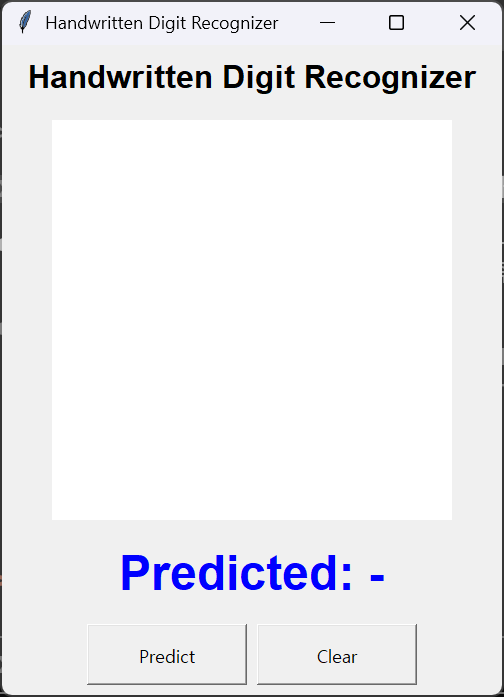
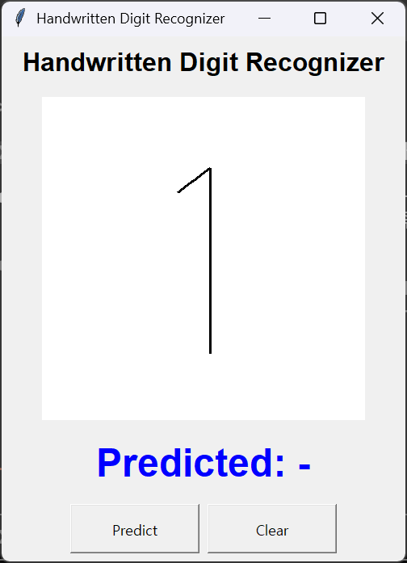
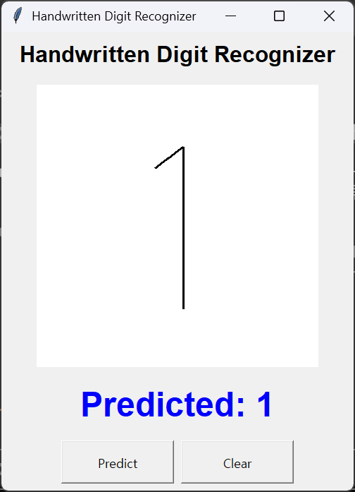

[← 전체 갤러리로](../SCREENSHOTS.md) · [다음: study_02 →](../study_02/SCREENSHOTS.md)

# 🖥️ study_01 · 손글씨 숫자 인식

캔버스에 마우스로 숫자(0~9)를 그리고 `Predict`를 누르면, 머신러닝 모델이 어떤 숫자인지 인식해서 결과를 보여주는 데스크톱 프로그램입니다.

## 한눈에 보기

| 항목 | 내용 |
| :--- | :--- |
| **분류** | 🖥️ 데스크톱 앱 |
| **하는 일** | 손글씨 숫자를 실시간으로 인식 |
| **기술** | Python, scikit-learn(Random Forest), Tkinter, Pillow |
| **실행 방법** | `pip install -r requirements.txt` 후 `python main.py` |
| **자세한 설명** | [`README.md`](README.md) |

> 처음 실행하면 모델을 학습하느라 10~15초 뒤에 창이 열립니다.

## 화면 구성

| 영역 | 설명 |
| :--- | :--- |
| 캔버스 (400x400) | 마우스로 숫자를 그리는 흰 영역 |
| `Predict` 버튼 | 그린 숫자를 인식 |
| `Clear` 버튼 | 캔버스를 지우고 새로 시작 |
| 결과 라벨 | `Predicted: N` 형식으로 인식 결과 표시 |

---

## 화면 보기

### 1. 시작 화면
빈 캔버스와 `Predict`, `Clear` 버튼이 있는 첫 화면입니다.

### 2. 숫자 그리기
캔버스에 마우스로 숫자 `1`을 그린 상태입니다.

### 3. 인식 결과
`Predict`를 누르면 아래에 인식 결과가 표시됩니다. `Clear`로 캔버스를 비우고 다시 그릴 수 있습니다.

---

> 촬영일 2026-11-19 · 실제 앱 실행 화면 (마우스 입력 이벤트를 코드로 재현해 촬영)

[← 전체 갤러리로](../SCREENSHOTS.md) · [다음: study_02 →](../study_02/SCREENSHOTS.md)
