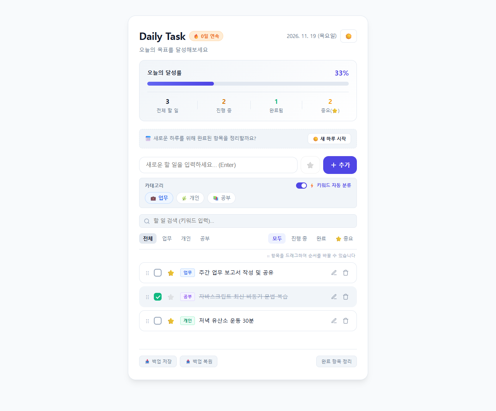
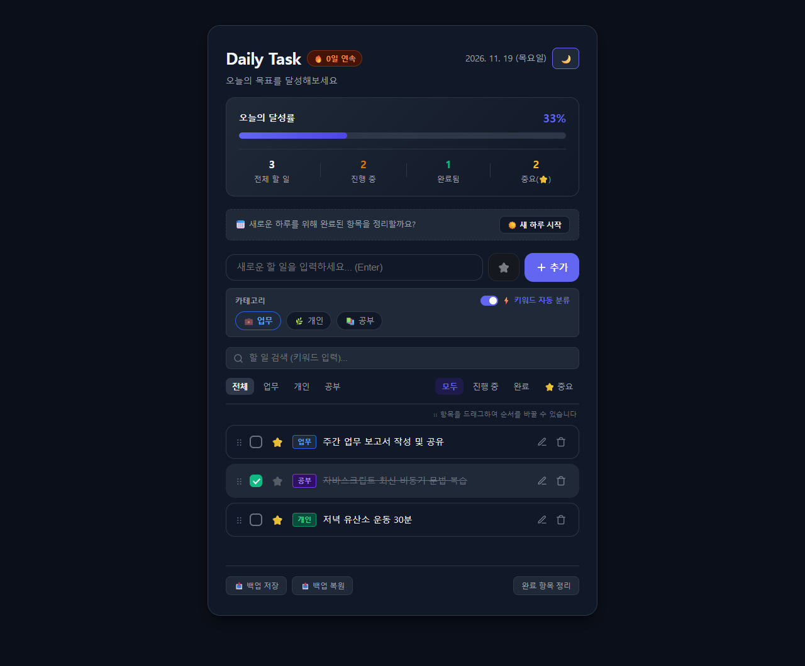
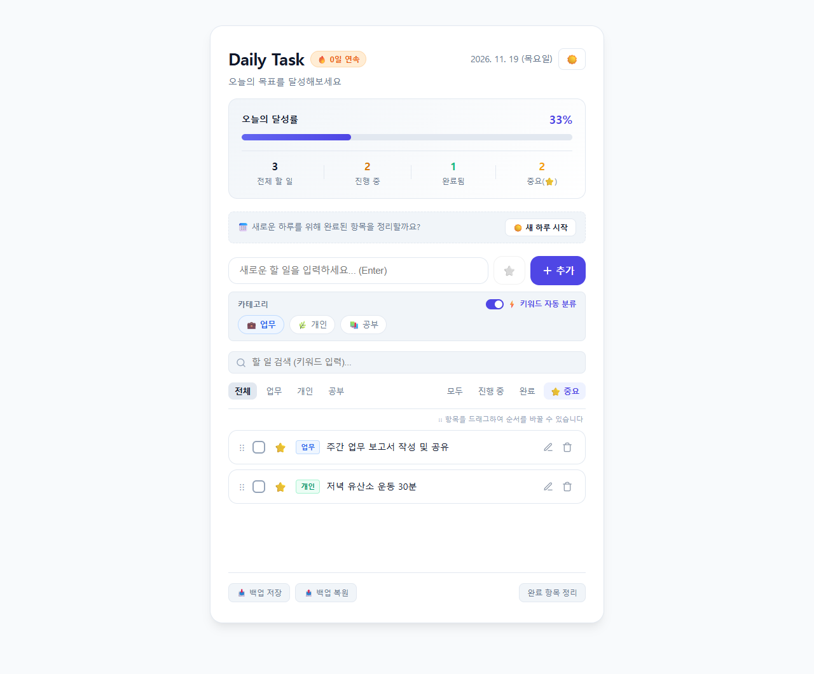
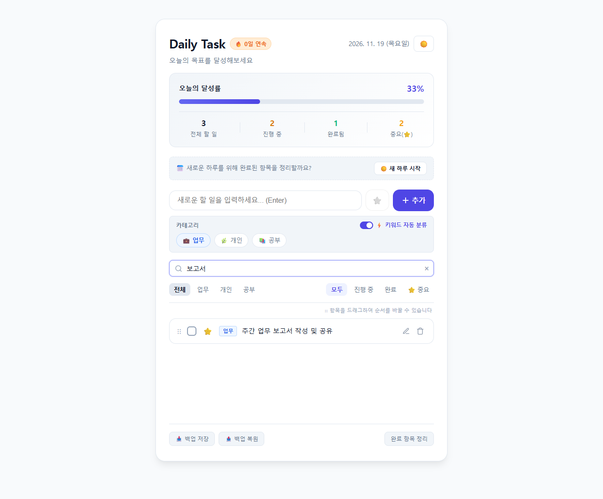
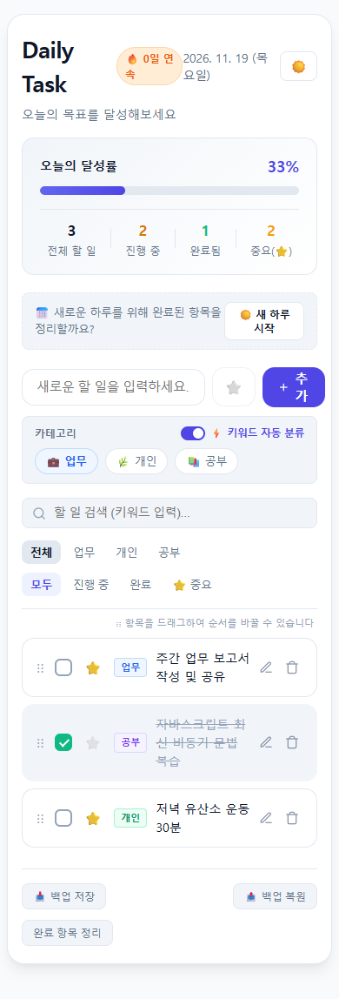

[← study_01](../study_01/SCREENSHOTS.md) · [전체 갤러리로](../SCREENSHOTS.md) · [다음: study_03 →](../study_03/SCREENSHOTS.md)

# 🌐 study_02 · 할 일 관리 (Daily Task Tracker)

하루 10~20개의 할 일을 관리하는 웹 앱입니다. 달성률 대시보드, 중요 표시, 검색, 드래그 정렬, 다크 모드를 지원합니다.

## 한눈에 보기

| 항목 | 내용 |
| :--- | :--- |
| **분류** | 🌐 웹 앱 (서버 없이 실행) |
| **하는 일** | 할 일 추가·완료·검색·정렬, 달성률 확인 |
| **기술** | HTML, CSS, JavaScript(Vanilla), 브라우저 `localStorage` |
| **실행 방법** | `index.html`을 브라우저에서 열기 (설치 불필요) |
| **자세한 설명** | [`README.md`](README.md) |

### 주요 기능
- 🎯 **달성률 대시보드:** 전체 / 진행 중 / 완료 / 중요 개수와 진행 바
- ⭐ **중요 표시:** 별표로 중요한 일만 모아보기
- 🔍 **실시간 검색:** 입력하는 즉시 목록 필터링
- 🔀 **드래그 앤 드롭:** 끌어서 우선순위 재배치
- 🌓 **다크 모드**와 📱 **모바일 대응**
- 🎉 올 클리어 축하 효과, 🔥 연속 달성 스트릭, 💾 JSON 백업/복원

---

## 화면 보기

### 1. 메인 화면
오늘의 달성률, 통계, 할 일 입력창, 카테고리 선택, 검색창, 필터 탭, 할 일 목록이 한 화면에 있습니다.

### 2. 다크 모드
우측 상단의 해/달 버튼으로 테마를 바꿉니다.

### 3. 중요(⭐) 필터
필터 탭에서 `중요`를 선택하면 별표를 단 할 일만 표시됩니다.

### 4. 키워드 검색
검색창에 `보고서`를 입력하면 일치하는 항목만 바로 보입니다.

### 5. 모바일 화면 (390px 폭)

---

> 촬영일 2026-11-19 · 처음 열었을 때 나오는 기본 샘플 할 일 3개가 표시된 화면

[← study_01](../study_01/SCREENSHOTS.md) · [전체 갤러리로](../SCREENSHOTS.md) · [다음: study_03 →](../study_03/SCREENSHOTS.md)
