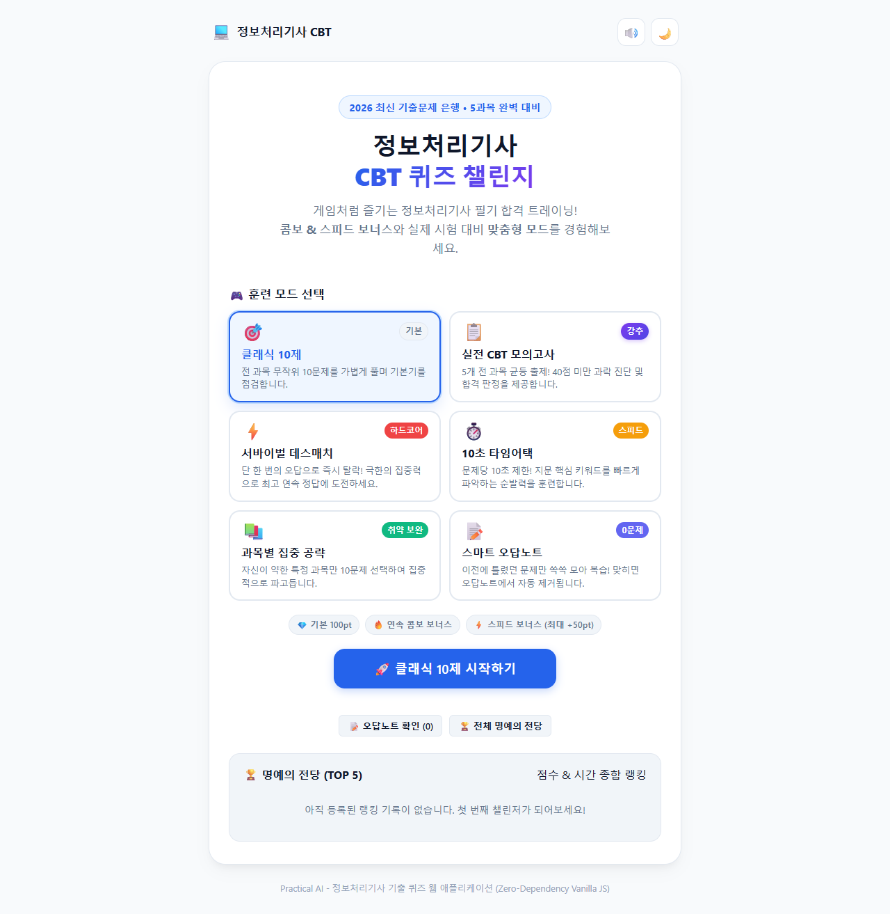
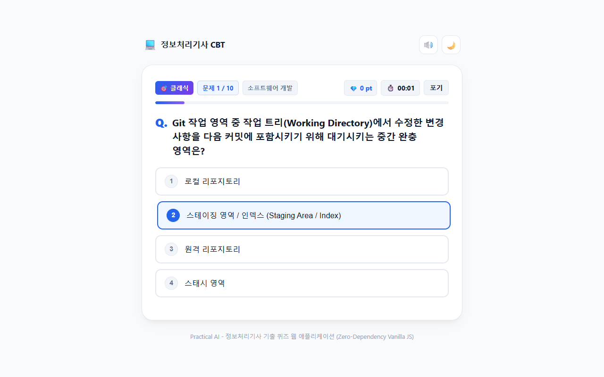
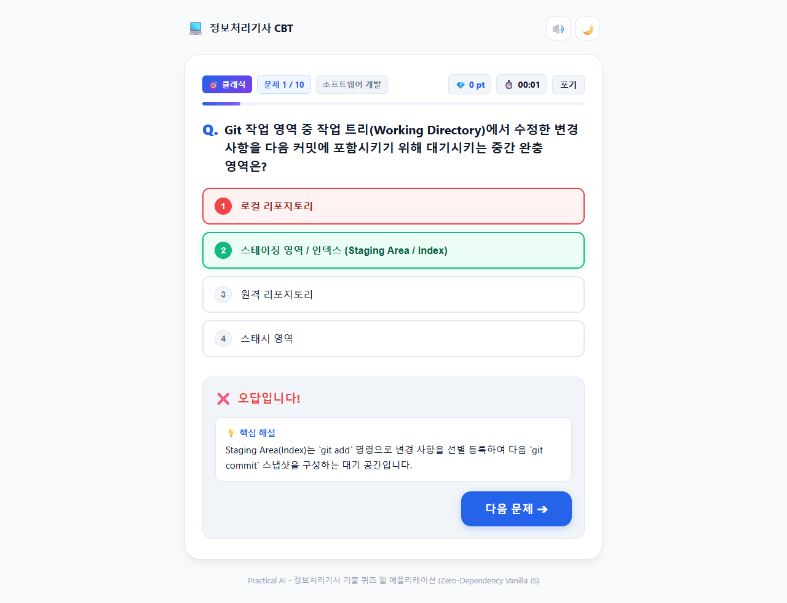
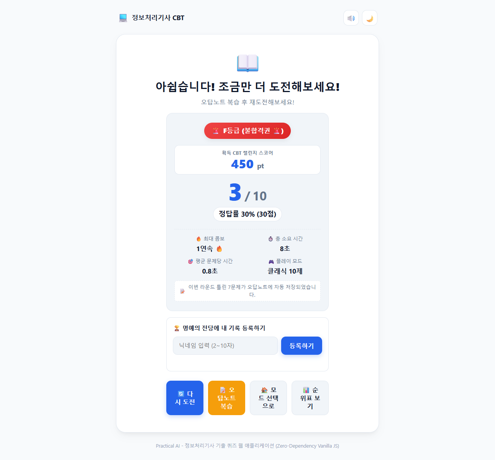
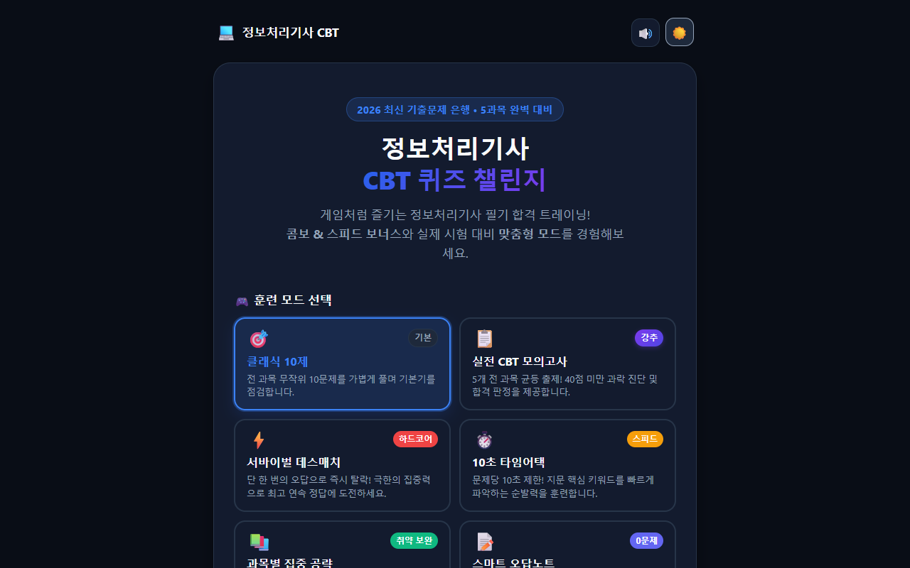

[← study_02](../study_02/SCREENSHOTS.md) · [전체 갤러리로](../SCREENSHOTS.md) · [다음: study_03_01 →](../study_03_01/SCREENSHOTS.md)

# 🌐 study_03 · 정보처리기사 기출 퀴즈 게임

정보처리기사 필기 기출문제를 게임처럼 풀 수 있는 웹 퀴즈 앱입니다. 6가지 모드, 점수와 콤보, 순위표, 오답노트를 지원합니다.

## 한눈에 보기

| 항목 | 내용 |
| :--- | :--- |
| **분류** | 🌐 웹 앱 (서버 없이 실행) |
| **하는 일** | 정보처리기사 기출 퀴즈 풀이와 오답 복습 |
| **기술** | HTML, CSS, JavaScript(Vanilla), Web Audio API, `localStorage` |
| **실행 방법** | `index.html`을 브라우저에서 열기 (설치 불필요) |
| **자세한 설명** | [`README.md`](README.md) |

### 게임 모드
| 모드 | 특징 |
| :--- | :--- |
| 🎯 클래식 10제 | 전 과목에서 무작위 10문제 |
| 📋 실전 CBT 모의고사 | 5과목 균등 출제, 과목별 과락 진단 |
| ⚡ 서바이벌 데스매치 | 한 번이라도 틀리면 탈락 |
| ⏱️ 10초 타임어택 | 문제당 10초 제한 |
| 📚 과목별 집중 공략 | 원하는 과목만 선택해서 학습 |
| 📝 스마트 오답노트 | 틀린 문제만 모아서 다시 풀기 |

---

## 화면 보기

### 1. 시작 화면 (모드 선택)
6가지 모드 중에서 고를 수 있습니다.

### 2. 문제 풀이 화면
문제 번호, 과목, 점수, 타이머와 4지선다 보기가 표시됩니다.

### 3. 정답 확인과 해설
보기를 고르면 정답(초록)과 내 답(빨강)이 표시되고, 핵심 해설이 나옵니다.

### 4. 결과 화면
점수, 정답률, 최대 콤보, 소요 시간이 나오고 오답은 오답노트에 자동 저장됩니다. 닉네임을 등록해 순위표에 올릴 수도 있습니다.

### 5. 다크 모드

---

> 촬영일 2026-11-19 · `클래식 10제` 모드를 실제로 플레이하며 촬영

[← study_02](../study_02/SCREENSHOTS.md) · [전체 갤러리로](../SCREENSHOTS.md) · [다음: study_03_01 →](../study_03_01/SCREENSHOTS.md)
