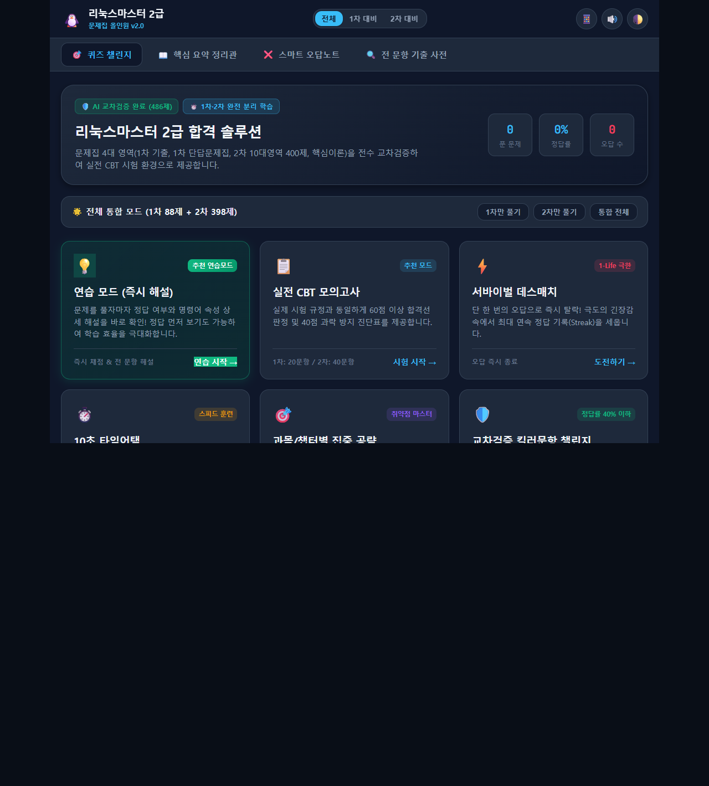
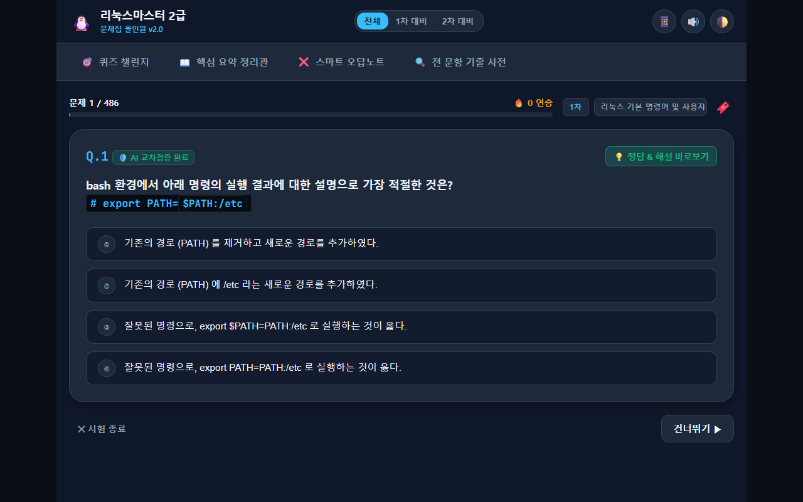
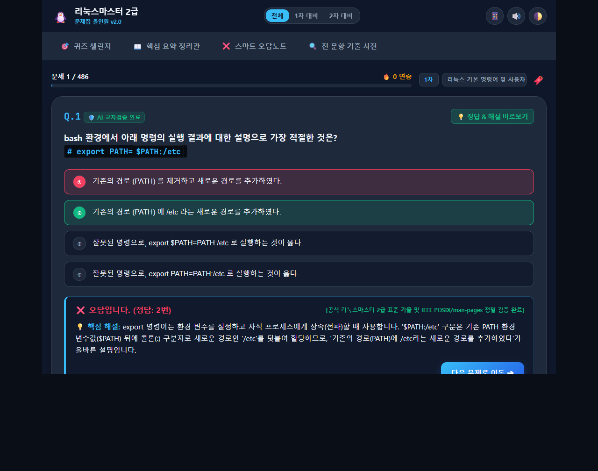
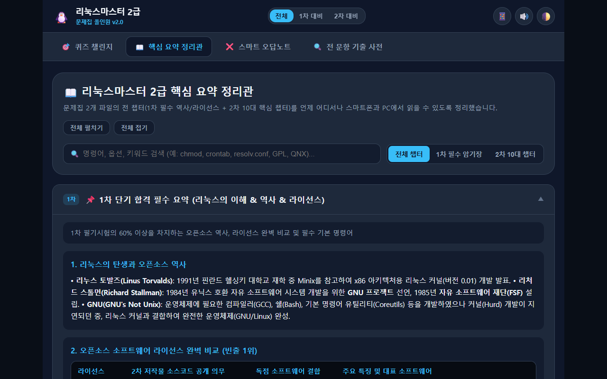
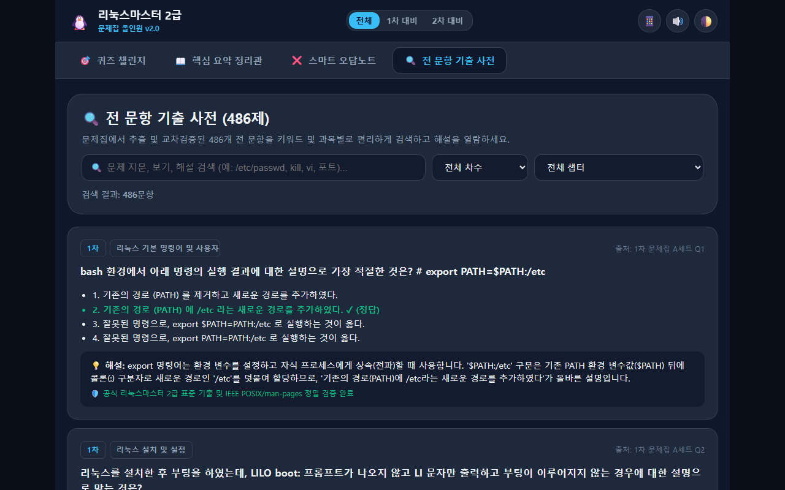
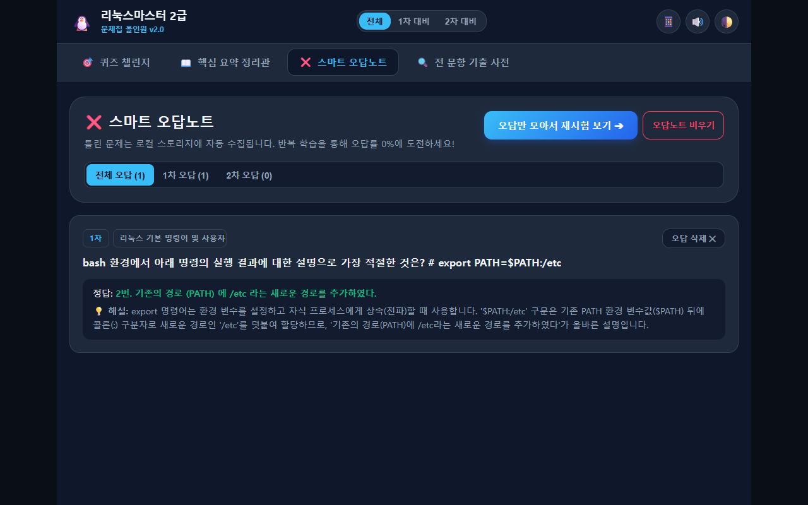
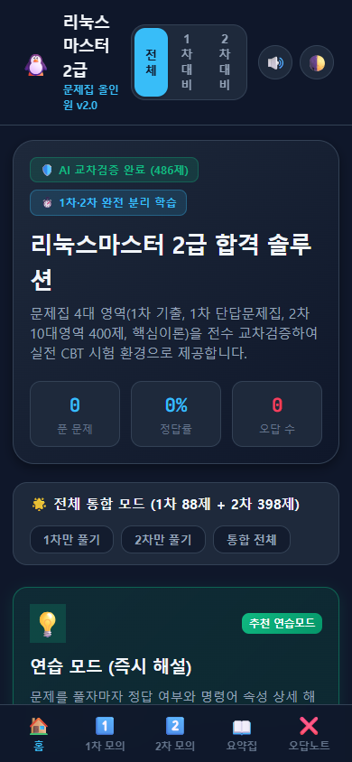

[← study_03](../study_03/SCREENSHOTS.md) · [전체 갤러리로](../SCREENSHOTS.md) · [다음: study_04 →](../study_04/SCREENSHOTS.md)

# 🌐 study_03_01 · 리눅스마스터 2급 CBT & 합격 마스터

리눅스마스터 2급 시험 대비 올인원 학습 앱입니다. 486개 기출 문항 퀴즈, 챕터별 핵심 요약, 오답노트, 전 문항 검색을 한곳에서 이용합니다.

## 한눈에 보기

| 항목 | 내용 |
| :--- | :--- |
| **분류** | 🌐 웹 앱 (서버 없이 실행) |
| **하는 일** | 리눅스마스터 2급 기출 풀이, 이론 요약 학습, 오답 복습 |
| **기술** | HTML, CSS, JavaScript(Vanilla), Web Audio API, `localStorage` |
| **실행 방법** | `index.html`을 브라우저에서 열기 (설치 불필요) |
| **모바일용 단일 파일** | `linux_master_offline.html` (인터넷 없이 스마트폰에서 실행) |
| **자세한 설명** | [`README.md`](README.md) |

### 4개 메뉴
| 메뉴 | 내용 |
| :--- | :--- |
| 🎯 퀴즈 챌린지 | 연습, 실전 모의고사, 서바이벌, 타임어택 등 퀴즈 모드 |
| 📖 핵심 요약 정리관 | 챕터별 핵심 이론 정리와 검색 |
| ❌ 스마트 오답노트 | 틀린 문제 자동 수집과 재시험 |
| 🔍 전 문항 기출 사전 | 486문항 검색과 해설 열람 |

---

## 화면 보기

### 1. 홈 화면 (퀴즈 챌린지)
상단 탭과 학습 통계, 연습 모드·실전 CBT 모의고사·서바이벌·10초 타임어택 등의 모드 카드가 있습니다. 기본 테마는 다크입니다.

### 2. 연습 모드 문제 화면
문제와 보기, 진행 상황(1/486), 연속 정답, `정답 & 해설 바로보기` 버튼이 보입니다.

### 3. 정답 확인과 해설
보기를 고르면 정답과 내 답이 표시되고 해설이 나옵니다. 아래는 첫 문제에서 1번을 골랐을 때의 화면입니다.

### 4. 핵심 요약 정리관
챕터별 핵심 이론이 펼침 형태로 정리되어 있고, 키워드 검색과 `전체 펼치기/접기`를 지원합니다.

### 5. 전 문항 기출 사전
486개 전 문항을 검색하고 차수·챕터별로 걸러 볼 수 있습니다.

### 6. 스마트 오답노트
틀린 문제가 자동으로 모입니다. 3번 화면에서 고른 1문제가 1차 오답으로 들어와 있습니다.

### 7. 모바일 화면 (390px 폭)

---

> 촬영일 2026-11-19 · 실제 앱을 조작하며 촬영

[← study_03](../study_03/SCREENSHOTS.md) · [전체 갤러리로](../SCREENSHOTS.md) · [다음: study_04 →](../study_04/SCREENSHOTS.md)
