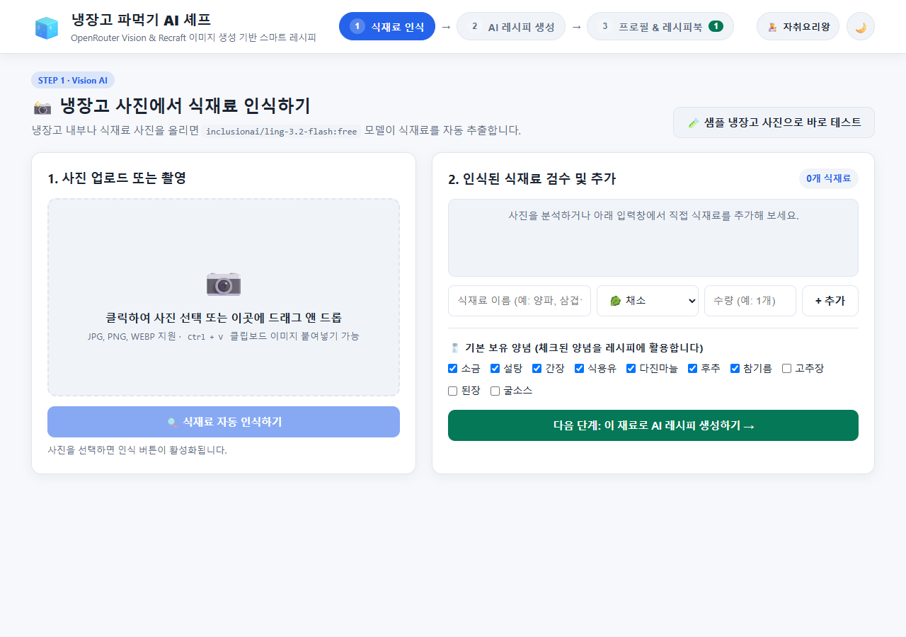
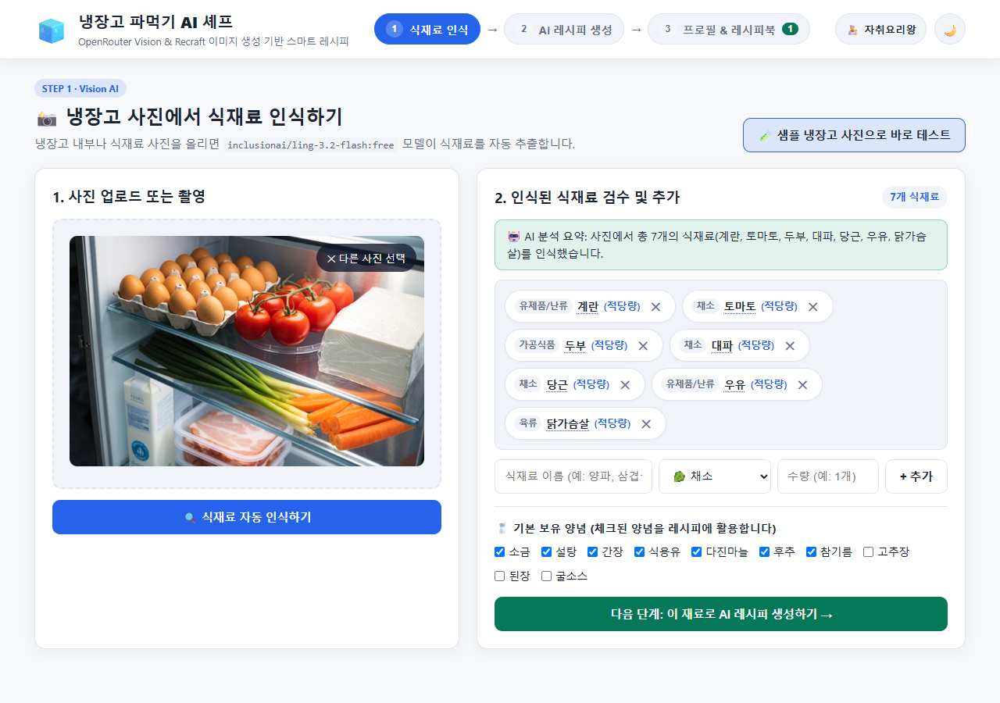
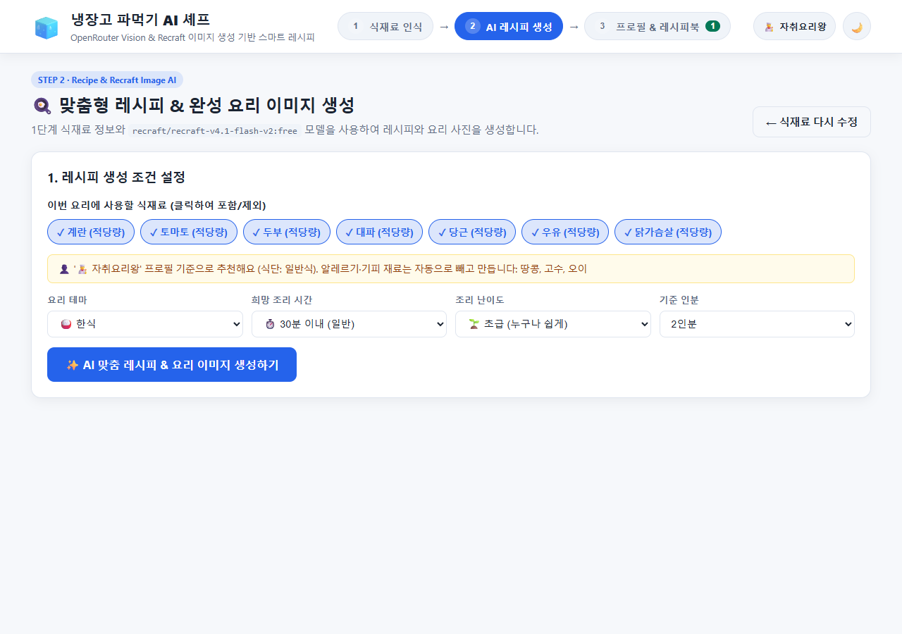
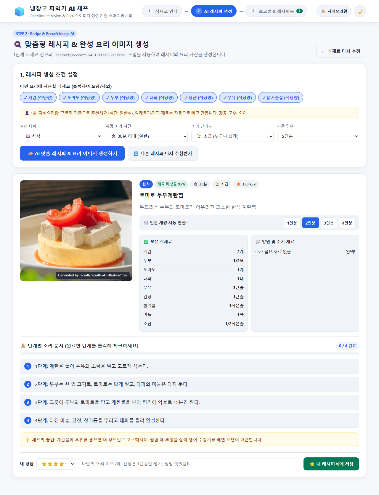
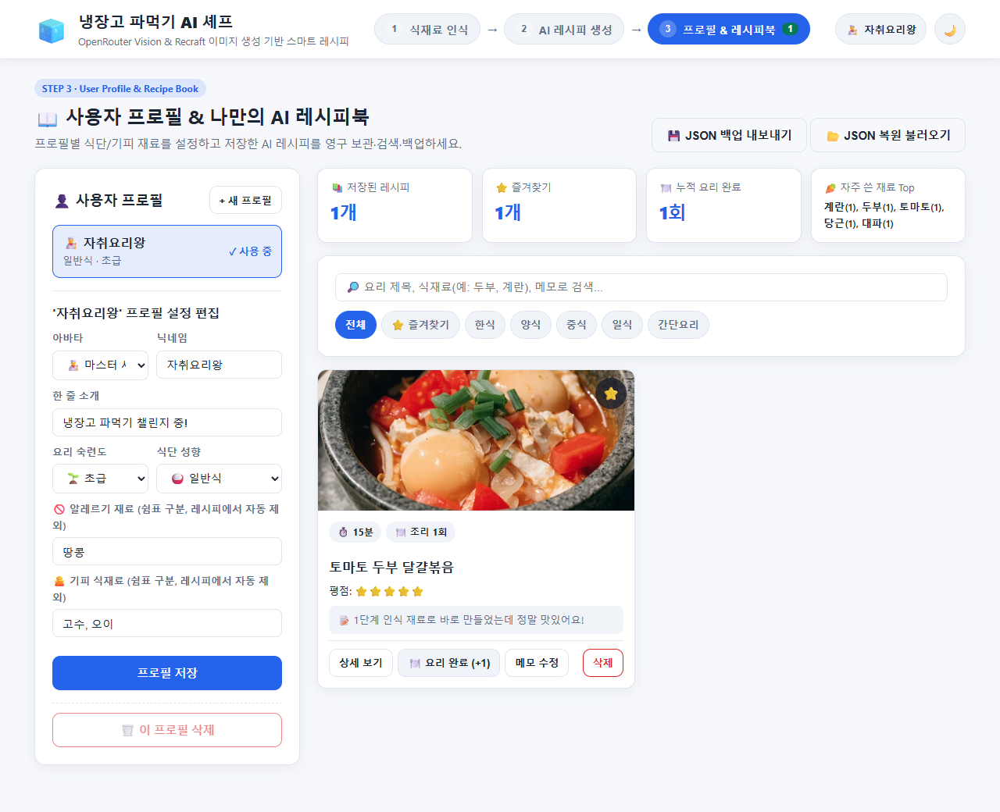
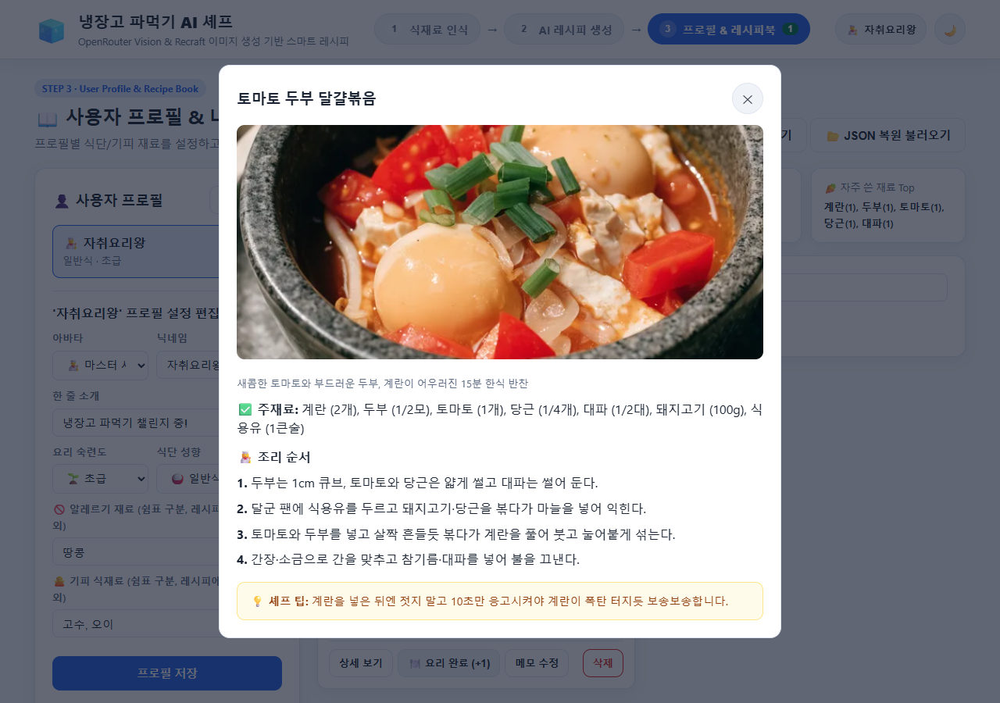
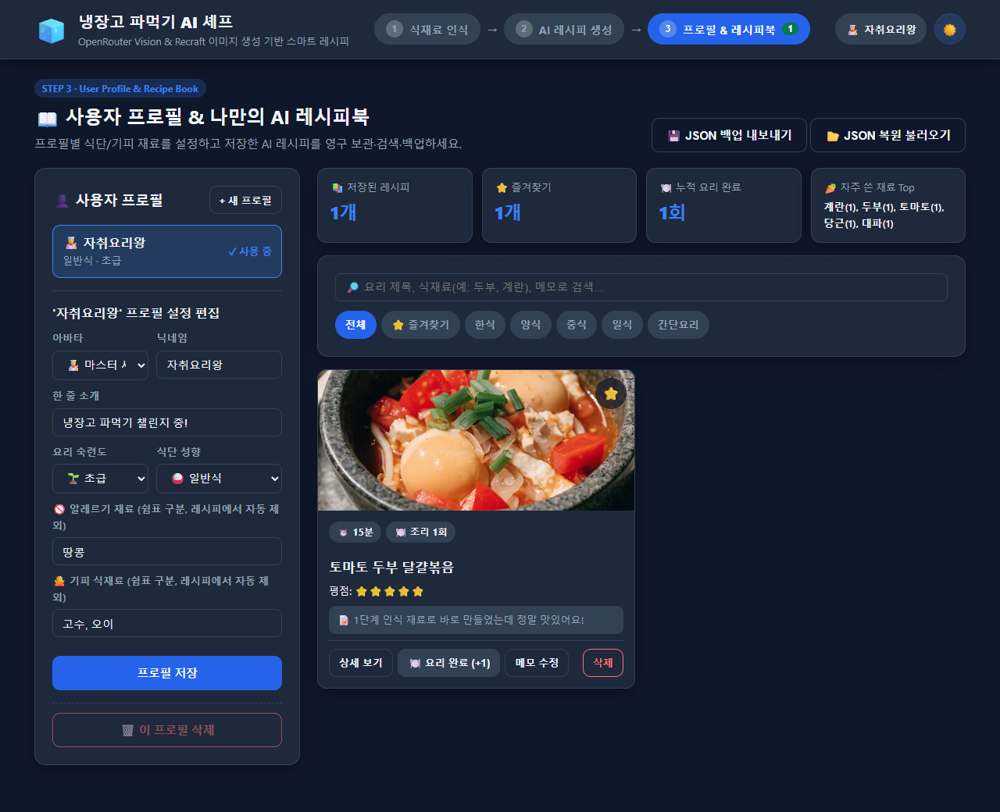

[← study_03_01](../study_03_01/SCREENSHOTS.md) · [전체 갤러리로](../SCREENSHOTS.md) · [다음: study_05 →](../study_05/SCREENSHOTS.md)

# 🤖 study_04 · 냉장고 파먹기 AI 셰프

냉장고 사진에서 식재료를 인식하고, 그 재료로 만들 수 있는 맞춤 레시피와 완성 요리 이미지를 생성하며, 마음에 드는 레시피는 프로필별 레시피북에 저장하는 AI 웹 앱입니다.

## 한눈에 보기

| 항목 | 내용 |
| :--- | :--- |
| **분류** | 🤖 AI 연동 웹 앱 (Flask + OpenRouter) |
| **하는 일** | 사진 속 식재료 인식 → AI 레시피·요리 이미지 생성 → 레시피북 저장 |
| **기술** | Python, Flask, httpx, Pillow, OpenRouter API(Vision·텍스트·이미지 생성) |
| **사용 AI 모델** | `inclusionai/ling-3.2-flash:free`(인식·레시피), `recraft/recraft-v4.1-flash-v2:free`(요리 이미지) |
| **실행 방법** | `.env`에 `OPENROUTER_API_KEY` 저장 → `python server.py` → http://127.0.0.1:5000 |
| **자세한 설명** | [`README.md`](README.md) |

### 3단계 구성
| 단계 | 하는 일 |
| :--- | :--- |
| **1단계** 식재료 인식 | 냉장고 사진을 올리면 AI가 식재료를 찾아 목록으로 정리 |
| **2단계** 레시피 생성 | 재료·요리 테마·시간·난이도·인분을 정하면 레시피와 요리 사진을 생성 |
| **3단계** 프로필 & 레시피북 | 알레르기·기피 재료 설정, 레시피 저장·즐겨찾기·평점·메모, JSON 백업 |

> 이 문서의 AI 결과 화면은 OpenRouter 무료 모델을 **실제로 호출한 결과**입니다. 3단계의 프로필 `자취요리왕`과 레시피 1개는 프로젝트에 들어 있는 샘플 데이터입니다.

---

## 화면 보기

### 1단계 · 식재료 인식

**1-1. 시작 화면**
사진을 올리거나 `샘플 냉장고 사진으로 바로 테스트`를 눌러 시작합니다. 상단에 3단계 진행 표시와 프로필, 테마 버튼이 있습니다.

**1-2. 인식 완료**
샘플 사진에서 AI가 7개 식재료(계란, 토마토, 두부, 대파, 당근, 우유, 고기)를 찾아 칩으로 보여줍니다. 재료는 삭제·추가할 수 있고, 기본 보유 양념도 고를 수 있습니다.

### 2단계 · AI 레시피 생성

**2-1. 생성 조건 설정**
이번 요리에 쓸 재료를 고르고 요리 테마·조리 시간·난이도·인분을 정합니다. 프로필의 알레르기·기피 재료(땅콩, 고수, 오이)는 자동으로 제외된다는 안내가 나옵니다.

**2-2. 생성된 레시피**
레시피 제목, 재료 일치율, 조리 시간, 완성 요리 이미지, 인분별 재료 계량 변환, 체크할 수 있는 단계별 조리 순서, 셰프 팁이 나옵니다. 아래에서 평점과 메모를 남기고 레시피북에 저장할 수 있습니다.

### 3단계 · 프로필 & 레시피북

**3-1. 레시피북**
프로필 편집, 저장 통계(저장 수·즐겨찾기·요리 완료 횟수·자주 쓴 재료), 검색·필터, 레시피 카드가 있습니다. JSON 백업 내보내기와 복원도 이 화면에서 합니다.

**3-2. 레시피 상세 보기**
카드의 `상세 보기`를 누르면 이미지, 주재료, 조리 순서, 셰프 팁이 팝업으로 열립니다.

**3-3. 다크 모드**

---

> 촬영일 2026-11-19 · 서버를 실제로 실행하고 1~3단계를 순서대로 조작하며 촬영

[← study_03_01](../study_03_01/SCREENSHOTS.md) · [전체 갤러리로](../SCREENSHOTS.md) · [다음: study_05 →](../study_05/SCREENSHOTS.md)
