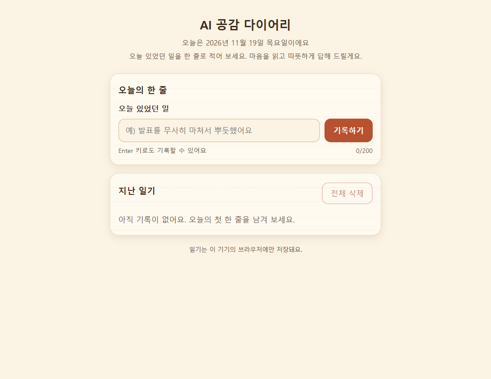
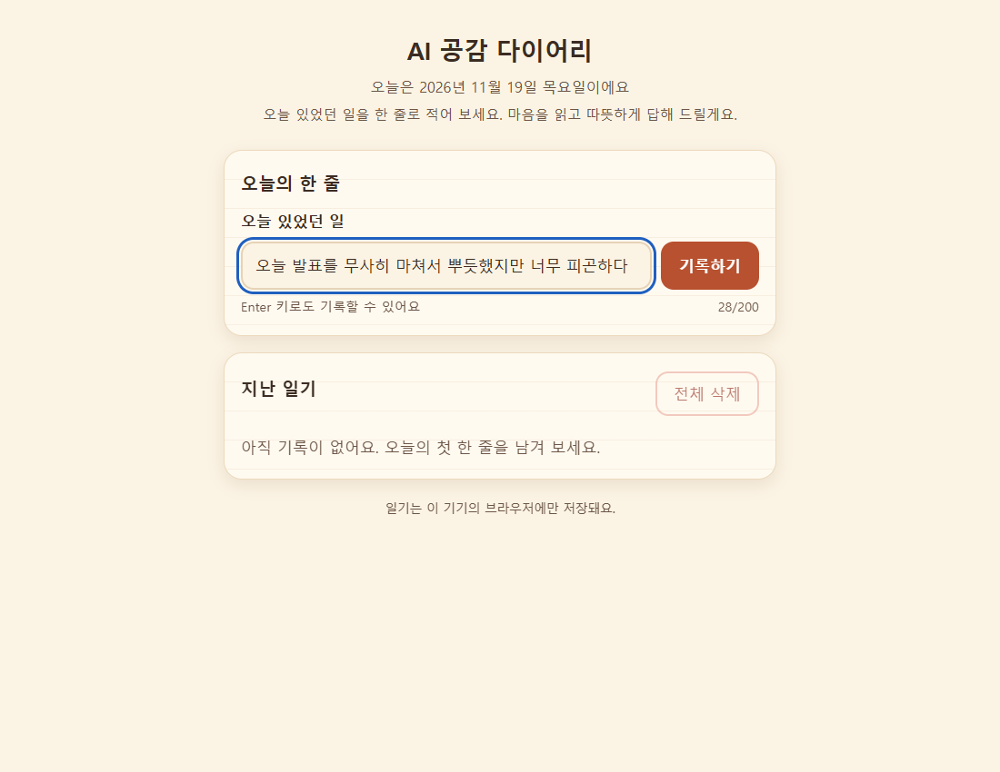
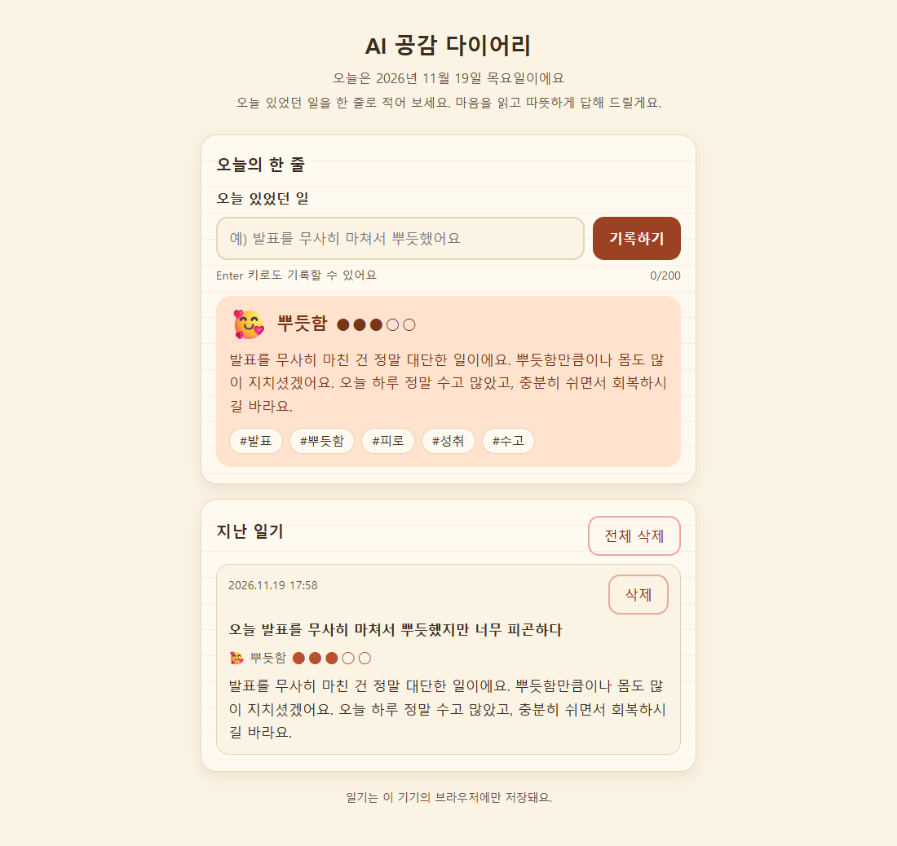
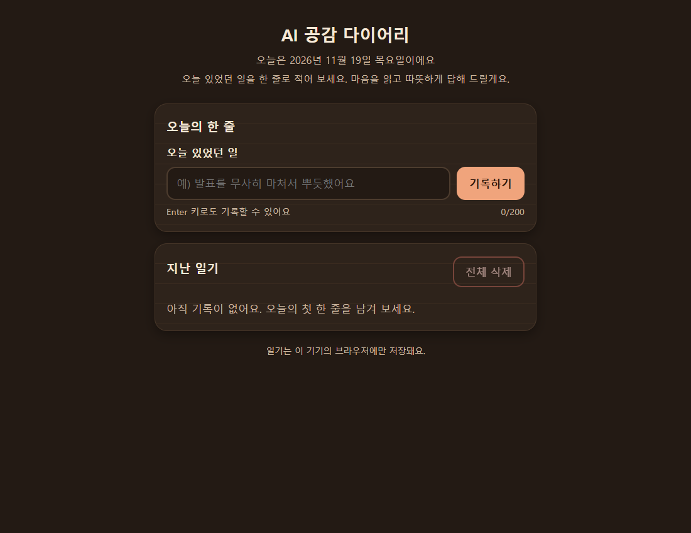
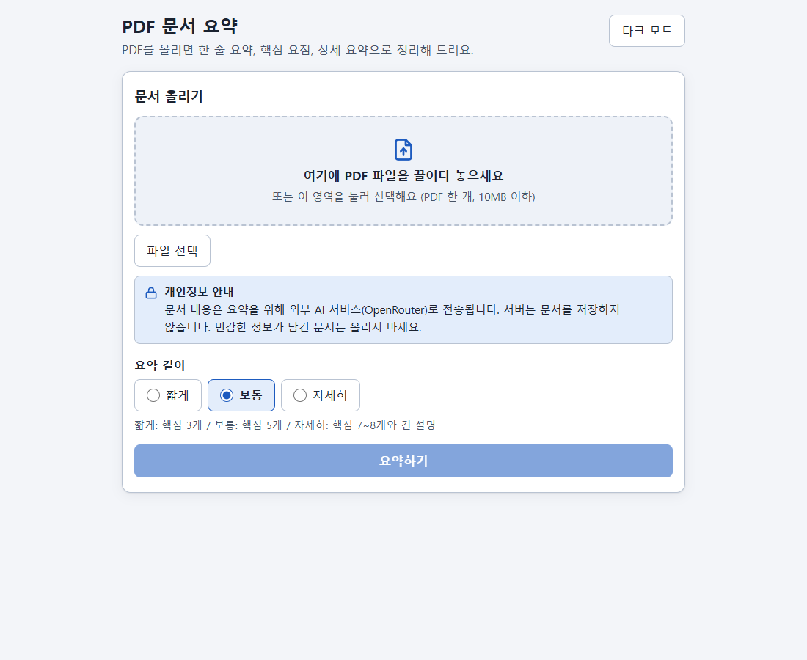
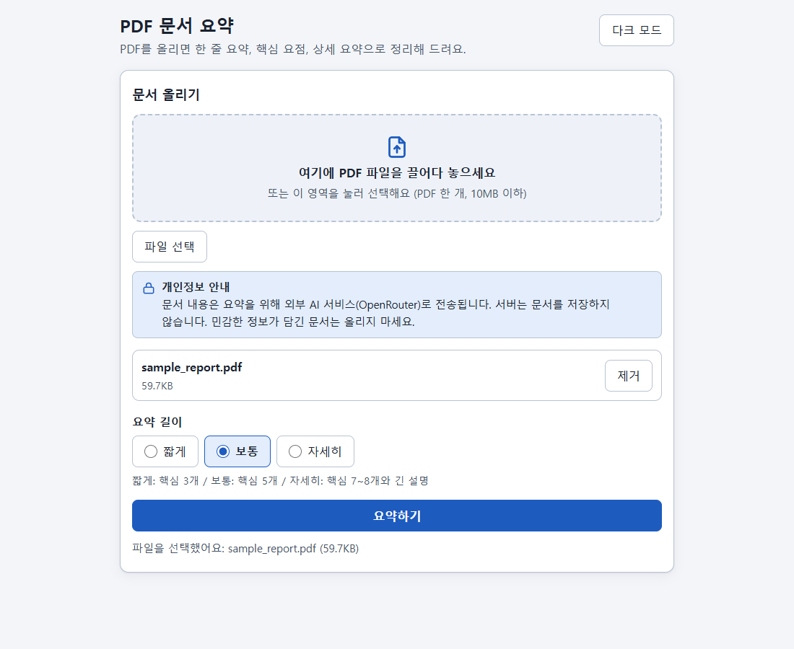
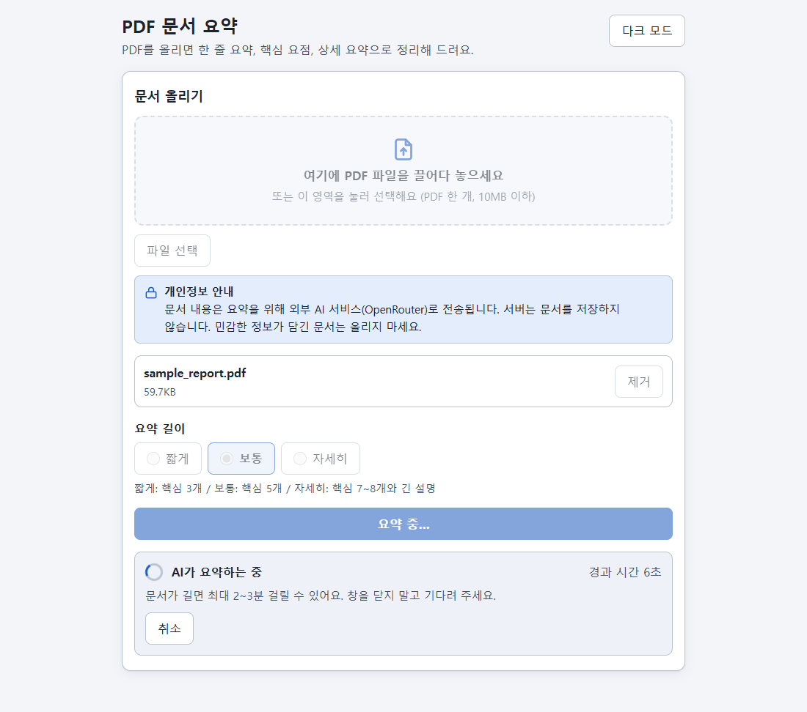
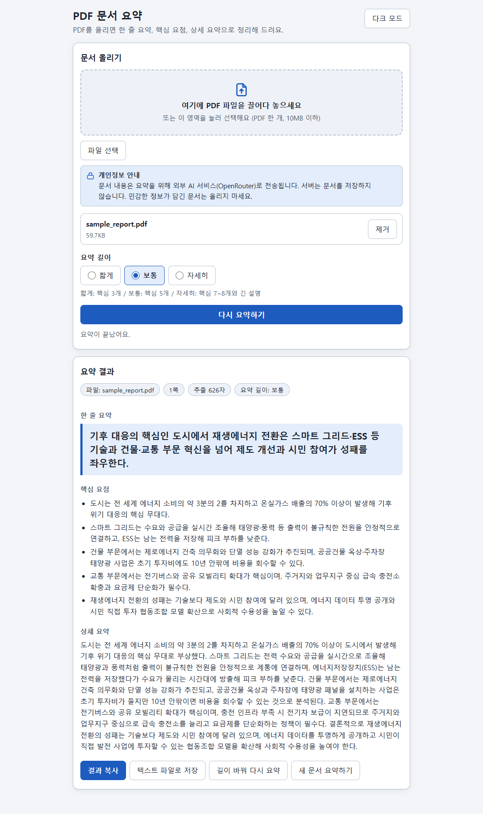

[← study_04](../study_04/SCREENSHOTS.md) · [전체 갤러리로](../SCREENSHOTS.md)

# 🤖 study_05 · AI 공감 다이어리 & PDF 문서 요약

AI를 활용한 웹 앱 두 가지가 들어 있는 프로젝트입니다.

- 📔 **AI 공감 다이어리:** 한 줄 일기를 쓰면 AI가 감정을 분석하고 따뜻하게 공감해 줍니다.
- 📄 **PDF 문서 요약:** PDF를 올리면 AI가 한 줄 요약, 핵심 요점, 상세 요약으로 정리해 줍니다.

## 한눈에 보기

| 항목 | 📔 AI 공감 다이어리 | 📄 PDF 문서 요약 |
| :--- | :--- | :--- |
| **분류** | 🤖 AI 연동 웹 앱 | 🤖 AI 연동 웹 앱 |
| **하는 일** | 일기 감정 분석 + 공감 메시지 | PDF 텍스트 추출 + 요약 |
| **화면 파일** | `index.html` | `index_pdf.html` |
| **서버 실행** | `python server.py` | `python server_pdf.py` |
| **접속 주소** | http://127.0.0.1:5000 | http://127.0.0.1:5001 |
| **설치** | `pip install -r requirements.txt` | `pip install -r requirements_pdf.txt` |
| **기술** | Flask, httpx, OpenRouter API | Flask, httpx, pypdf, OpenRouter API |
| **저장 방식** | 브라우저 `localStorage` (서버에 저장 안 함) | 저장 안 함 (서버는 문서를 보관하지 않음) |

- **사용 AI 모델:** `inclusionai/ling-3.2-flash:free` (OpenRouter 무료 모델)
- **준비물:** 이 폴더의 `.env`에 `OPENROUTER_API_KEY` 저장
- **기획 문서:** PDF 요약 앱의 요구사항은 [`PRD_pdf.md`](PRD_pdf.md)에 있습니다.

> 이 문서의 AI 결과 화면은 OpenRouter 무료 모델을 **실제로 호출한 결과**입니다.

---

## 📔 A. AI 공감 다이어리

### A-1. 시작 화면
오늘 날짜와 한 줄 입력창, `기록하기` 버튼, 글자 수 카운터(0/200)가 있는 따뜻한 일기장 스타일의 화면입니다.

### A-2. 일기 입력
한 줄 일기(`오늘 발표를 무사히 마쳐서 뿌듯했지만 너무 피곤하다`)를 입력한 상태입니다.

### A-3. AI 감정 분석과 공감 메시지
AI가 감정(뿌듯함)과 강도(5단계 중 3), 공감·위로 메시지, 키워드 칩을 보여줍니다. 아래 `지난 일기`에는 기록이 쌓입니다.

### A-4. 다크 모드
기기가 다크 모드일 때의 화면입니다.

---

## 📄 B. PDF 문서 요약

> 촬영에는 직접 만든 한글 샘플 PDF(1쪽, '스마트 도시와 재생에너지 전환' 주제의 가상 보고서)를 사용했습니다.

### B-1. 시작 화면
PDF를 끌어다 놓거나 `파일 선택`으로 올립니다. 문서 내용이 외부 AI 서비스로 전송된다는 개인정보 안내가 항상 표시됩니다.

### B-2. 파일 선택
파일명과 크기가 표시되고, 요약 길이(짧게/보통/자세히)를 고를 수 있습니다.

### B-3. 요약 진행
스피너와 경과 시간이 표시되고, `취소` 버튼으로 중단할 수 있습니다.

### B-4. 요약 결과
문서 정보(파일명·쪽수·추출 글자 수), 한 줄 요약, 핵심 요점, 상세 요약이 표시됩니다. 결과 복사, 텍스트 파일 저장, 길이 바꿔 다시 요약, 새 문서 요약하기 버튼이 있습니다.

---

> 촬영일 2026-11-19 · 서버를 실제로 실행하고 조작하며 촬영

[← study_04](../study_04/SCREENSHOTS.md) · [전체 갤러리로](../SCREENSHOTS.md)
